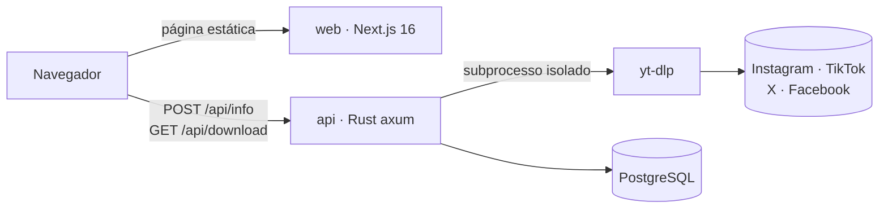

<div align="center">

# ⚡ Nowvi

**Baixe vídeos de qualquer rede, num lugar só.**

Cole o link de um vídeo do TikTok, X, Facebook ou Instagram e baixe em MP4, sem cadastro e sem
marca d'água. É grátis até 720p e custa R$ 2 em Full HD no Pix.

[**Acessar o Nowvi**](https://web-production-41797e.up.railway.app) ·
[API](https://api-production-eec1.up.railway.app/health) ·
[Versões](https://github.com/emersonjds/nowvi/tags)


</div>

---

## Como funciona

1. **Cole o link** do vídeo que você copiou no app da rede.
2. **Escolha a qualidade**: até 720p é grátis, depois de 30 segundos de anúncio, e o Full HD 1080p custa R$ 2 no Pix.
3. **Baixe o MP4.** O arquivo vai direto para o seu aparelho, e nenhuma cópia fica no servidor.

| Rede | Situação |
|---|---|
| TikTok | ✅ funcionando, sem marca d'água |
| X (Twitter) | ✅ funcionando |
| Facebook | ⚠️ ainda não validado em produção |
| Instagram | 🚧 bloqueado, com correção em andamento (NOWVI-20) |
| YouTube | 🔜 depois (NOWVI-14) |

## Arquitetura



- **web** (`apps/web`): Next.js 16 com App Router sobre o
  [next-shadcn-admin-dashboard](https://github.com/arhamkhnz/next-shadcn-admin-dashboard), Tailwind 4,
  shadcn/ui e zod. É uma página só, com os estados encadeados (link, qualidade, espera e
  download), e as landings por rede são geradas de forma estática.
- **api** (`crates/nowvi-api`): axum + sqlx. Chama o `yt-dlp` sem shell e envia o vídeo direto do
  stdout para o navegador, sem gravar em disco. Um token HMAC só libera o download grátis depois
  da espera do anúncio.
- **banco**: Postgres, com as métricas agregadas de download e os pedidos de Pix. As migrations
  rodam no boot.

### Segurança

- Só aceita links das 4 redes (host e extractor), o que fecha o SSRF.
- No máximo 2 processos por IP e rate limit por IP (IPv6 agrupado por /64), com limites de tempo,
  tamanho e saída.
- O `yt-dlp` roda com o ambiente limpo, numa versão fixa conferida por SHA-256, e a imagem roda
  como usuário não-root.
- O web manda CSP, `frame-ancestors 'none'` e `nosniff`. O anúncio roda num iframe sandbox e só
  depois do consentimento (LGPD).
- O log não guarda a URL do usuário.

### SEO e GEO

- Metadata em pt-BR, OpenGraph e JSON-LD (`WebApplication`, `FAQPage` e `HowTo`).
- Landings `/baixar-video-instagram`, `/baixar-video-tiktok`, `/baixar-video-x` e
  `/baixar-video-facebook`.
- `sitemap.xml`, um `robots.txt` aberto aos bots de IA e um
  [`llms.txt`](https://web-production-41797e.up.railway.app/llms.txt) para os LLMs recomendarem o Nowvi.

## Estrutura

```
apps/web/            front Next.js
crates/nowvi-api/    API Rust
design/              telas do Stitch (fonte visual)
docs/specs/          spec da v0 e copy de SEO
.claude/             guia do projeto e agents
```

## Rodando localmente

Pré-requisitos: Node 24, Rust 1.97, Docker Desktop e `yt-dlp` (`brew install yt-dlp`).

```bash
# Banco
docker run -d --rm --name nowvi-pg -e POSTGRES_PASSWORD=x -p 55432:5432 postgres:16-alpine

# API, em http://localhost:8080
cd crates/nowvi-api
cp .env.example .env    # gere o segredo com: openssl rand -hex 32
set -a; source .env; set +a
cargo run

# Web, em http://localhost:3000
cd apps/web
npm install
NEXT_PUBLIC_API_URL=http://localhost:8080 NEXT_PUBLIC_SITE_URL=http://localhost:3000 npm run dev
```

### Variáveis

| Serviço | Variável | Uso |
|---|---|---|
| api | `DATABASE_URL` | Postgres |
| api | `DOWNLOAD_TOKEN_SECRET` | segredo HMAC (32+ bytes) |
| api | `WEB_ORIGIN` | origens liberadas no CORS e destino do redirect de erro |
| api | `AD_WAIT_SECONDS` | espera do anúncio (padrão 30) |
| api | `MAX_CONCURRENT_JOBS` | processos `yt-dlp` simultâneos (padrão 6) |
| web | `NEXT_PUBLIC_API_URL` | URL pública da API, definida no build |
| web | `NEXT_PUBLIC_SITE_URL` | URL canônica do site, definida no build |
| web | `NEXT_PUBLIC_ADSTERRA_BANNER_KEY` | chave do banner (opcional) |

### Verificação

```bash
cd crates/nowvi-api && cargo fmt --check && cargo clippy --all-targets -- -D warnings
cd apps/web && npm run check && npx tsc --noEmit && npm run build

# Antes de cada release
cd apps/web && npm audit --omit=dev
cd crates/nowvi-api && cargo audit   # cargo install cargo-audit
```

## Deploy

O deploy é no [Railway](https://railway.com), com 3 serviços: `web`, `api` e `Postgres`. Cada app
tem o seu `Dockerfile`, com as imagens base fixadas por digest. O healthcheck (`/health` na api e `/`
no web) e a política de restart ficam na config do serviço (`railway environment edit`). Todo push na
`main` publica.

| Serviço | URL |
|---|---|
| web | https://web-production-41797e.up.railway.app |
| api | https://api-production-eec1.up.railway.app |

O domínio `nowvi.com.br` entra em breve (NOWVI-5).

## Fluxo de trabalho

- O backlog fica no [santi](https://github.com/emersonjds/santi), no projeto `NOWVI`. Cada card vira uma branch `feat|fix|chore|docs/NOWVI-<n>-<resumo>`.
- A `developer` é a branch de integração, e a `main` é a de release. A `developer` vai para a `main` só por PR, e cada release ganha uma tag semver.
- Os commits seguem o Conventional Commits, em inglês.

## Próximos passos

- Instagram de volta (NOWVI-20).
- Pix pela AbacatePay (NOWVI-2) e Full HD 1080p (NOWVI-13).
- Rede de anúncios (NOWVI-4).
- Servidor MCP em `/mcp` (NOWVI-12).
- Testes com cobertura acima de 90% (NOWVI-15).

---

<div align="center">
<sub>O Nowvi não é afiliado ao Instagram, TikTok, X ou Facebook. Use só para conteúdo próprio ou autorizado.</sub>
</div>
